# Yorick — champion mod for TFM2 League Heroes

Pixel-art **Yorick** champion mod for [TFM2-League-Heroes](https://github.com/BoDUD/TFM2-League-Heroes):
a 42×45 px chibi tank sprite set (8 strips: idle, run, attack, skill, skill2, ult, hit, dead)
plus Waters-of-Life maiden and ghoul summons, built by per-frame sampling of the skeletal
animation clips of the publicly viewable Yorick 3D model, quantized to a 31-colour palette.

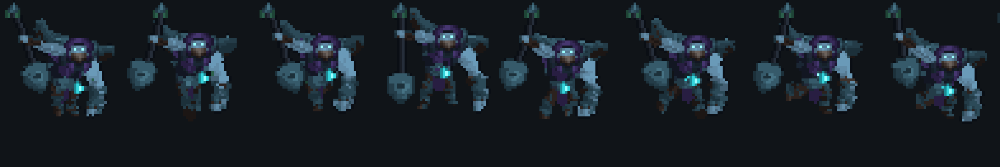

## Preview

| | |
|---|---|
| 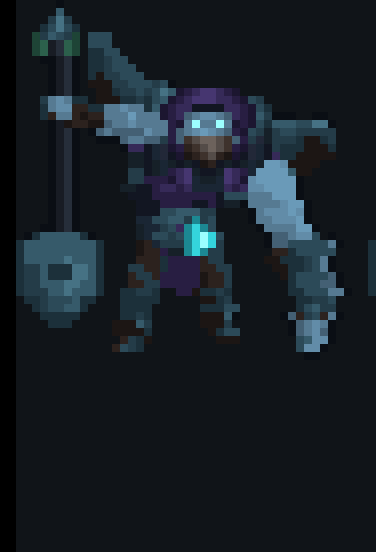 | 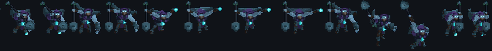 |

Full sheet: [preview/sheet_3x.png](preview/sheet_3x.png)

## Motion (animated)

All loops assembled from the exported sprite sheet at the `.fanim` native frame durations,
soles-aligned, 4× nearest-neighbour. `hit` and `dead` strips play once; the rest loop.

### Yorick

| idle | run | attack | skill |
|---|---|---|---|
| 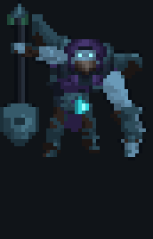 | 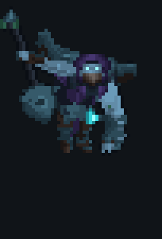 | 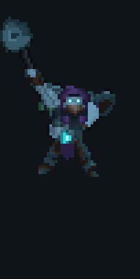 | 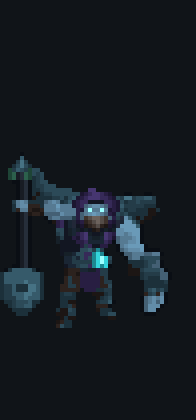 |
| **skill2** | **ult** | **hit** | **dead** |
| 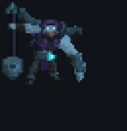 | 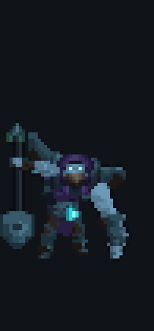 | 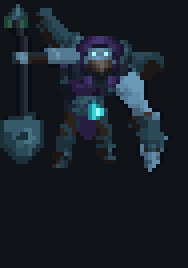 | 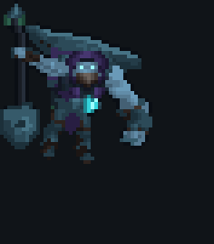 |

### Maiden (Waters of Life summon)

| idle | run | attack | hit | dead |
|---|---|---|---|---|
| 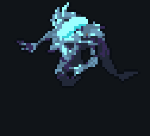 | 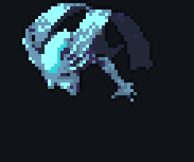 | 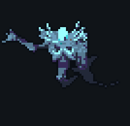 | 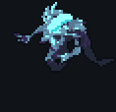 | 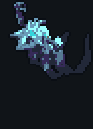 |

### Ghoul summon

| idle | run | attack | hit | dead |
|---|---|---|---|---|
| 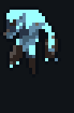 | 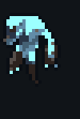 | 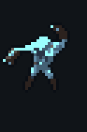 | 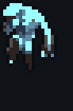 | 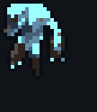 |

## Install

Copy this folder (or the release zip) into your TFM2 mods directory and load it with the game's
mod loader; see the TFM2-League-Heroes repository for mod-loading instructions. The mod is the
`mod/` tree exactly as the game consumes it (`league_yorick.dll` / `.so`, champion data, sheets,
`.fanim` animation files, icons, effects, addon Rust source).

## Contents

- `mod/` — the installable mod (v0.7.0)
- `preview/` — verification renders of the exported sprite sheet
- `LICENSE` — MIT (original code and pixel art in this repository)
- `NOTICE.md` — fan-content and attribution statement; read before redistributing

## Quality record (v0.7.0, independently verified)

- Tight idle frame 42×45 px, inside the TFM2 tank height band; 100 frames across 18 strips
- 31-colour palette; 0 gold pixels; 0.00% non-cyan pixels above luminance 150 (BT.601 and BT.709)
- Run cycle: consecutive upper-silhouette IoU max 66.8% (real stride, lean and arm swing)
- One-look consistency: idle vs run 92.0%, idle vs ult 100.0% top-60 silhouette IoU
- Prop attachment: single connected component in 100/100 frames; hand intersects spade shaft
  in every frame; green finial tassels, no cyan orphans
- Sheet-level oracle measured directly off the exported `#sheet.png` + `#anim.fanim`

## Reproducibility

- `tools/build_yorick_v070.py` — the v0.7.0 builder: per-frame sampling of the skeletal clips
  (`yorick_idle1`, `yorick_run_base`, `yorick_attack1`, `yorick_spell1`, `yorick_spell3`,
  `yorick_spell4`, `yorick_death`) from the publicly viewable Yorick GLB
  (`cdn.modelviewer.lol/.../models/yorick/83000/model.glb`), bone-voting, palette quantization,
  sheet + `.fanim` packing.
- `tools/rig_yorick_v070.py` — the sheet-level verification oracle (`get_tight`, `top60_iou`,
  attachment and palette assertions) that produced the quality record above.
- Both scripts carry absolute `/home/user/...` path constants from their original sandbox;
  adjust to your checkout before running. Builder first, oracle second.

## Credits

- TFM2 engine, mod API and tooling conventions: BoDUD, TFM2-League-Heroes (MIT)
- Sprite pipeline: per-frame GLB clip sampling + palette quantization scripts (author)
